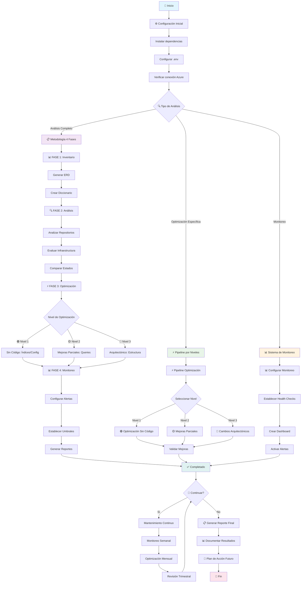

# 🔄 Diagrama de Flujo - SQL Analysis Project

## 📊 Flujo Principal de Uso



## 🎯 Comandos por Flujo

### **Análisis Completo (4 Fases)**
```bash
# Ejecutar metodología completa
python3 cli.py workflow

# Por fases individuales
python3 cli.py workflow 1    # Inventario
python3 cli.py workflow 2    # Análisis
python3 cli.py workflow 3    # Optimización
python3 cli.py workflow 4    # Monitoreo
```

### **Pipeline de Optimización**
```bash
# Pipeline completo
python3 cli.py pipeline

# Por niveles específicos
python3 cli.py pipeline 1    # Sin código
python3 cli.py pipeline 2    # Mejoras parciales
python3 cli.py pipeline 3    # Arquitectónico
```

### **Monitoreo Continuo**
```bash
# Configurar monitoreo
python3 cli.py monitor

# Generar reportes
python3 tools/database_specific_manager.py persqldbmotorpromocprd report

# Ejecutar pruebas
python3 cli.py test-suite
```

## 📋 Puntos de Decisión Clave

### **1. Tipo de Análisis**
- **Completo:** Para análisis integral inicial
- **Específico:** Para optimizaciones puntuales
- **Monitoreo:** Para seguimiento continuo

### **2. Nivel de Optimización**
- **🟢 Nivel 1:** Cambios sin impacto en código (2-4 semanas)
- **🟡 Nivel 2:** Mejoras con cambios menores (1-2 meses)
- **🔵 Nivel 3:** Cambios arquitectónicos (3-6 meses)

### **3. Frecuencia de Mantenimiento**
- **Semanal:** Monitoreo de métricas
- **Mensual:** Optimizaciones menores
- **Trimestral:** Revisión completa
- **Semestral:** Evaluación arquitectónica
