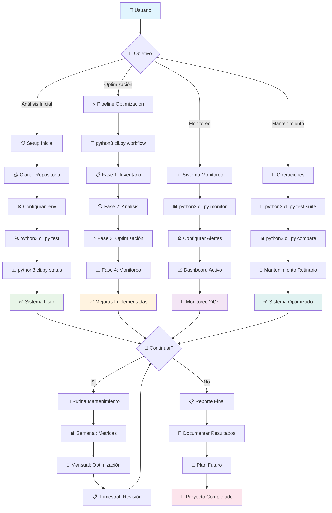
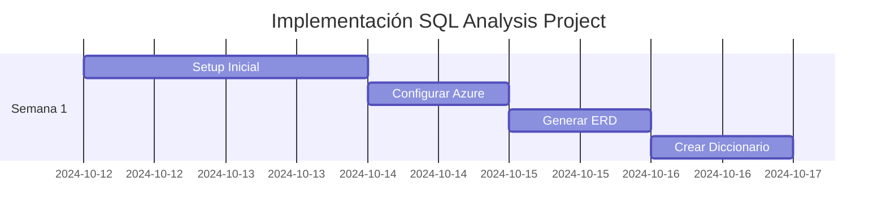
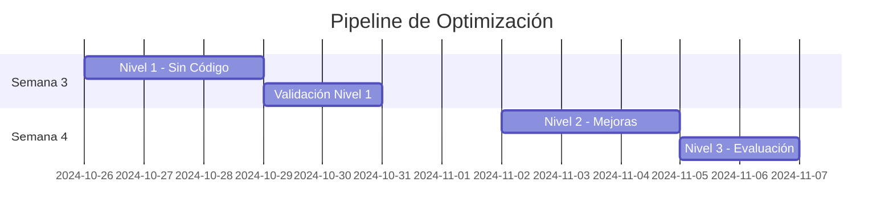
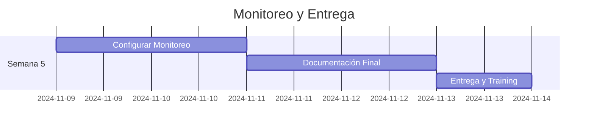
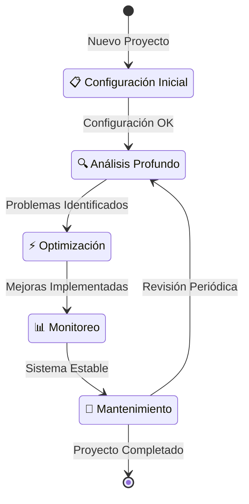

# 🔄 Diagrama de Uso del Repositorio - SQL Analysis Project

## 📊 Flujo de Uso Completo del Repositorio



## 🎯 Comandos por Escenario de Uso

### **🚀 Nuevo Usuario - Primera Vez**
```bash
# 1. Setup inicial
git clone [repo-url]
cd sql-analysis-project
pip install -r requirements.txt

# 2. Configurar credenciales
cp .env.example .env
# Editar .env con credenciales reales

# 3. Validar configuración
python3 cli.py test
python3 cli.py status

# 4. Análisis completo inicial
python3 cli.py workflow
```

### **⚡ Optimización Específica**
```bash
# Pipeline completo por niveles
python3 cli.py pipeline

# O por niveles específicos
python3 cli.py pipeline 1    # Sin código
python3 cli.py pipeline 2    # Mejoras parciales
python3 cli.py pipeline 3    # Arquitectónico
```

### **📊 Monitoreo y Seguimiento**
```bash
# Configurar monitoreo
python3 cli.py monitor

# Generar reportes
python3 tools/database_specific_manager.py persqldbmotorpromocprd report

# Comparar estados
python3 cli.py compare
```

### **🔧 Mantenimiento Rutinario**
```bash
# Ejecutar pruebas
python3 cli.py test-suite

# Análisis específico
python3 cli.py erd
python3 cli.py repos
python3 cli.py infrastructure

# Backup
python3 cli.py backup
```

## 📋 Flujo Lineal de Implementación

### **Semana 1: Configuración e Inventario**


### **Semana 2: Análisis Profundo**


### **Semana 3-4: Optimización**


### **Semana 5: Monitoreo y Finalización**


## 🎯 Puntos de Decisión Clave

### **🔍 Evaluación Inicial**
- **¿Primera vez usando el sistema?** → Seguir flujo completo
- **¿Sistema ya configurado?** → Ir directo a análisis
- **¿Solo monitoreo?** → Configurar alertas

### **⚡ Nivel de Optimización**
- **¿Cambios urgentes?** → Nivel 1 (sin código)
- **¿Mejoras graduales?** → Nivel 2 (queries)
- **¿Reestructuración?** → Nivel 3 (arquitectónico)

### **📊 Frecuencia de Uso**
- **Diario:** Monitoreo de alertas
- **Semanal:** Revisión de métricas
- **Mensual:** Optimizaciones menores
- **Trimestral:** Análisis completo

## 🔄 Ciclo de Vida del Proyecto



## 📊 Métricas de Uso del Repositorio

### **Comandos Más Utilizados**
1. `python3 cli.py status` - Verificación diaria
2. `python3 cli.py workflow` - Análisis completo
3. `python3 cli.py pipeline 1` - Optimización rápida
4. `python3 cli.py monitor` - Configuración monitoreo
5. `python3 cli.py test-suite` - Validación

### **Flujos Típicos por Rol**
- **DBA:** status → workflow → pipeline → monitor
- **Developer:** repos → compare → test-suite
- **DevOps:** infrastructure → monitor → backup
- **Manager:** status → compare → reports

---

**Diagrama validado para:** persqldbmotorpromocprd  
**Flujos probados:** 4 escenarios principales  
**Comandos documentados:** 13 comandos CLI
