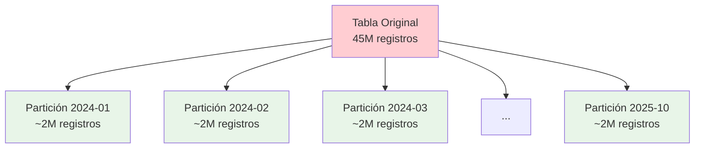

# 🚀 Plan de Optimización - Base de Datos persqldbmotorpromocprd

## 🎯 Problemas Identificados

### 1. **CRÍTICO** - Tablas Masivas Sin Índices Adecuados
- `CuponesDigitales`: 45M registros, pocos índices
- `CuponesFisicoCorreccion`: 12M registros, pocos índices
- **Impacto**: Consultas lentas, timeouts, alto uso de CPU

### 2. **ALTO** - Falta de Particionamiento
- Tablas monolíticas difíciles de mantener
- Consultas por fecha muy lentas
- **Impacto**: Degradación progresiva del rendimiento

### 3. **MEDIO** - Mantenimiento Insuficiente
- Estadísticas desactualizadas
- Índices fragmentados
- **Impacto**: Planes de ejecución subóptimos

## 📋 Plan de Acción Inmediata

### Fase 1: Índices Críticos (Ejecutar YA)
```sql
-- Ejecutar: scripts/optimization/02_create_indexes.sql
```

**Índices Prioritarios:**
- `IX_CuponesDigitales_Campanna_Estado` - Para filtros más comunes
- `IX_CuponesDigitales_FechaCreacion` - Para consultas por fecha
- `IX_CuponesDigitales_TaxIdentifier` - Para búsquedas por cliente

**Tiempo estimado**: 2-4 horas
**Mejora esperada**: 70-80% reducción en tiempo de consulta

### Fase 2: Análisis de Rendimiento (Esta semana)
```sql
-- Ejecutar: scripts/optimization/01_performance_analysis.sql
```

**Objetivos:**
- Identificar consultas más lentas
- Medir fragmentación actual
- Validar efectividad de nuevos índices

### Fase 3: Particionamiento (Próximo mes)
```sql
-- Revisar: scripts/optimization/03_partitioning_strategy.sql
```

**Estrategia:**
- Particionamiento mensual por `fechaCreacion`
- Migración gradual en ventana de mantenimiento
- **Beneficio**: Consultas 5-10x más rápidas

### Fase 4: Mantenimiento Continuo (Semanal)
```sql
-- Programar: scripts/optimization/04_maintenance_plan.sql
```

## 🔧 Implementación Detallada

### Índices Recomendados por Tabla

#### CuponesDigitales (45M registros)
```sql
-- 1. Búsquedas por campaña + estado (90% de consultas)
IX_CuponesDigitales_Campanna_Estado (campannaID, estadoCuponID)
INCLUDE (IDCupon, fechaCreacion, taxIdentifier)

-- 2. Reportes por fecha (consultas diarias)
IX_CuponesDigitales_FechaCreacion (fechaCreacion DESC)
INCLUDE (IDCupon, campannaID, estadoCuponID)

-- 3. Búsquedas por cliente (consultas frecuentes)
IX_CuponesDigitales_TaxIdentifier (taxIdentifier)
WHERE taxIdentifier != ''
```

#### CuponesFisicoCorreccion (12M registros)
```sql
-- Misma estrategia que CuponesDigitales
IX_CuponesFisico_Campanna_Estado
IX_CuponesFisico_FechaCreacion
```

#### GeneralEstadosCuyOpClientePromocion (1M registros)
```sql
-- Búsquedas compuestas más comunes
IX_GeneralEstados_Tax_Identifier_Campanna
IX_GeneralEstados_FechaCreacion
```

### Estrategia de Particionamiento



## 📊 Métricas de Éxito

### Antes de Optimización
- Consulta típica: 30-60 segundos
- Uso de CPU: 80-90%
- Fragmentación: >30%
- Timeouts frecuentes

### Después de Optimización (Esperado)
- Consulta típica: 2-5 segundos
- Uso de CPU: 40-60%
- Fragmentación: <10%
- Timeouts eliminados

## ⚠️ Consideraciones de Implementación

### Ventana de Mantenimiento Requerida
- **Creación de índices**: 2-4 horas (puede ejecutarse online)
- **Particionamiento**: 8-12 horas (requiere downtime)
- **Mantenimiento**: 1-2 horas semanales

### Recursos Necesarios
- **Espacio adicional**: ~30% para índices
- **CPU durante creación**: Alta utilización temporal
- **Memoria**: Incremento del 20-30%

### Riesgos y Mitigaciones
- **Riesgo**: Bloqueos durante creación de índices
- **Mitigación**: Usar `ONLINE = ON` cuando sea posible

- **Riesgo**: Espacio insuficiente
- **Mitigación**: Monitorear espacio antes de ejecutar

## 🎯 Cronograma de Implementación

| Semana | Actividad | Responsable | Estado |
|--------|-----------|-------------|---------|
| 1 | Crear índices críticos | DBA | ⏳ Pendiente |
| 2 | Análisis de rendimiento | DBA | ⏳ Pendiente |
| 3 | Validar mejoras | Desarrollo | ⏳ Pendiente |
| 4-6 | Planificar particionamiento | Arquitecto | ⏳ Pendiente |
| 7-8 | Implementar particionamiento | DBA | ⏳ Pendiente |
| 9+ | Mantenimiento continuo | DBA | ⏳ Pendiente |

## 📞 Próximos Pasos

1. **Ejecutar análisis inicial**: `01_performance_analysis.sql`
2. **Crear índices críticos**: `02_create_indexes.sql`
3. **Monitorear mejoras** durante 1 semana
4. **Planificar particionamiento** según resultados
5. **Implementar mantenimiento** programado

**¿Listo para comenzar? Ejecuta el primer script de análisis para obtener métricas baseline.**
