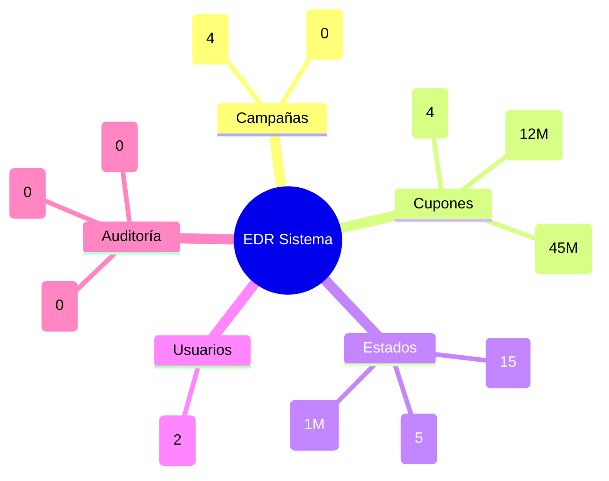
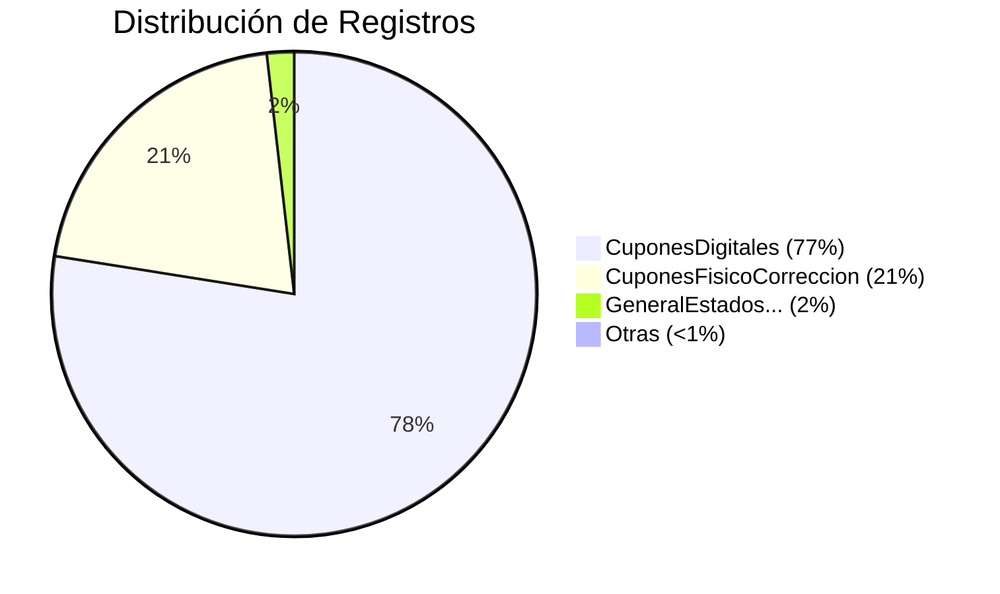
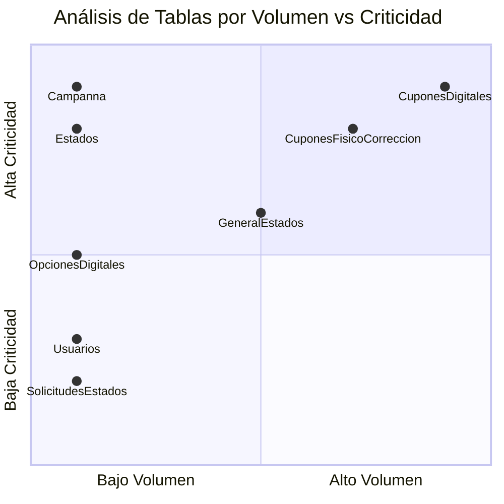

# 📊 Diagramas EDR - Base de Datos persqldbmotorpromocprd

## 📋 Índice de Diagramas

### 1. [EDR Completo](./EDR_Mermaid.md)
- Diagrama de relaciones completo
- Vista simplificada de negocio  
- Flujo de datos

### 2. [Tablas Individuales](./Tablas_Individuales_Mermaid.md)
- Estructura detallada de cada tabla
- Campos y tipos de datos
- Diagrama de volumen de datos
- Dependencias entre tablas

### 3. [Arquitectura del Sistema](./Arquitectura_Sistema_Mermaid.md)
- Arquitectura de capas
- Flujo de datos principal
- Modelo por dominios
- Análisis de rendimiento

## 🎯 Vista Rápida del Sistema

## 📈 Métricas Clave

| Métrica | Valor |
|---------|-------|
| **Total Tablas** | 12 |
| **Total Registros** | ~58M |
| **Tabla más grande** | CuponesDigitales (45M) |
| **Relaciones FK** | 6 |
| **Tablas con CASCADE** | 2 |

## 🔍 Análisis Visual

### Distribución de Datos

### Criticidad por Volumen

## 🚀 Cómo Usar los Diagramas

1. **Para Desarrolladores**: Consulta [Tablas Individuales](./Tablas_Individuales_Mermaid.md)
2. **Para Arquitectos**: Revisa [Arquitectura del Sistema](./Arquitectura_Sistema_Mermaid.md)
3. **Para Analistas**: Usa [EDR Completo](./EDR_Mermaid.md)

## 📝 Notas Importantes

- Los diagramas Mermaid se pueden visualizar en GitHub, GitLab, o herramientas compatibles
- Para editar: usa [Mermaid Live Editor](https://mermaid.live/)
- Los volúmenes de datos son aproximados al momento del análisis

## 🔧 Herramientas Recomendadas

- **Visualización**: GitHub/GitLab (nativo)
- **Edición**: Mermaid Live Editor
- **Documentación**: Markdown + Mermaid
- **Exportación**: mermaid-cli para PNG/SVG
