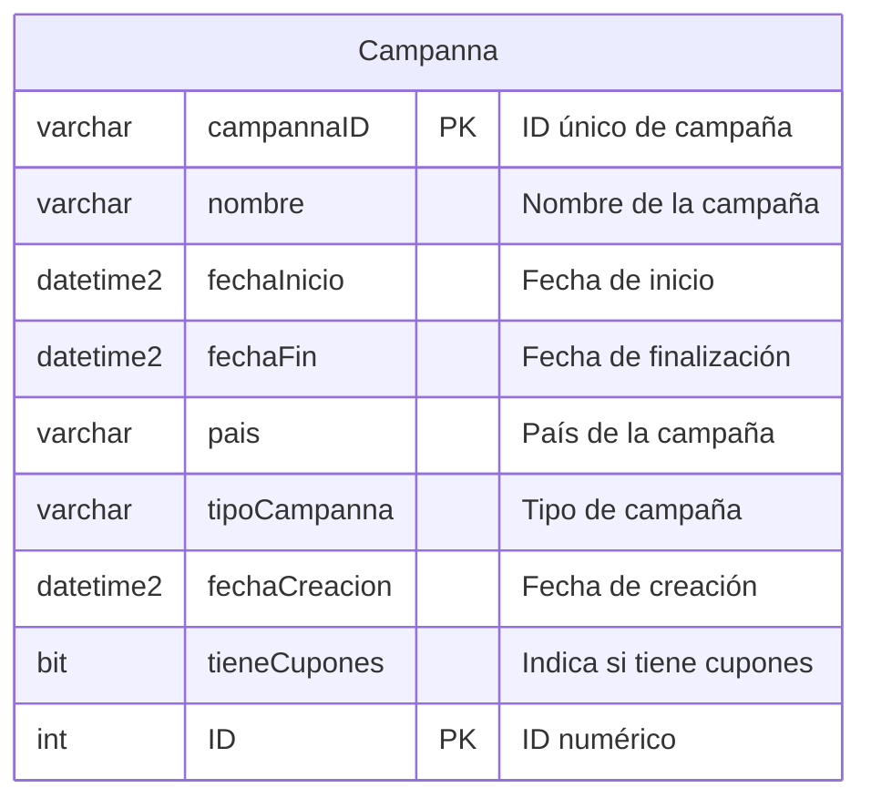
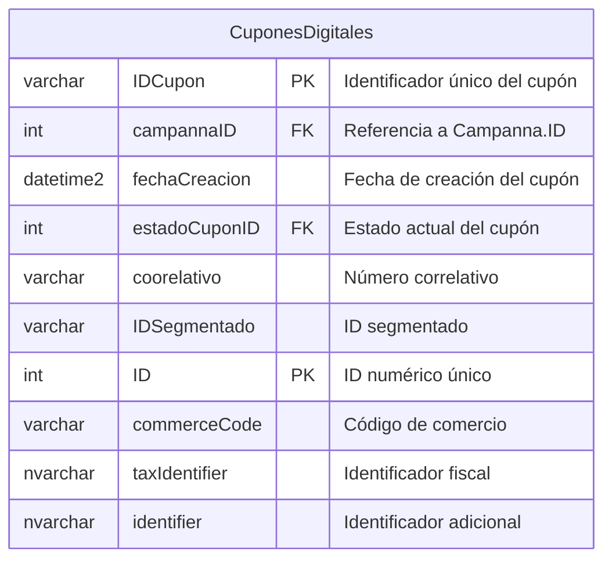
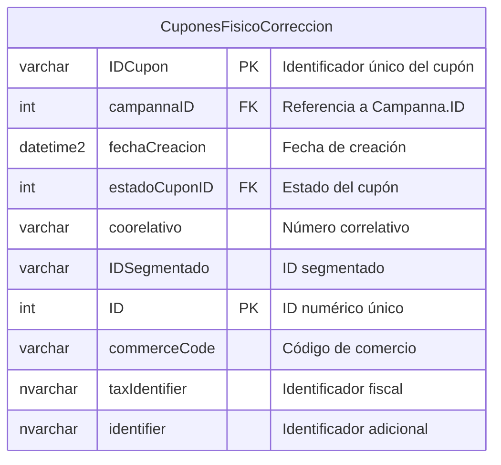
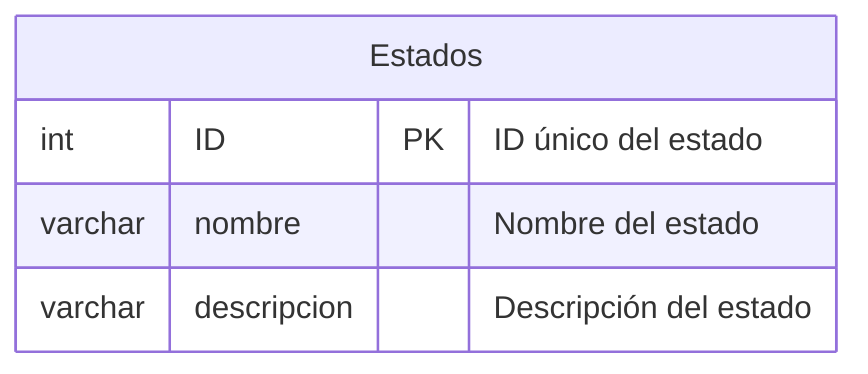
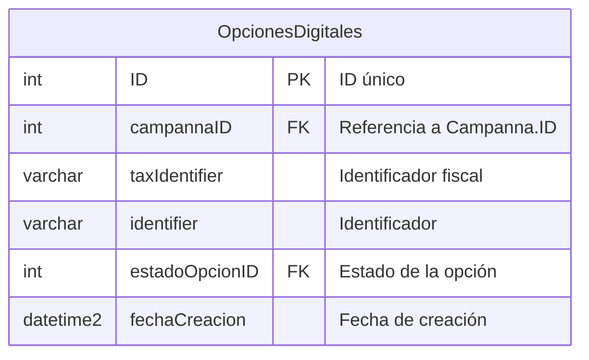
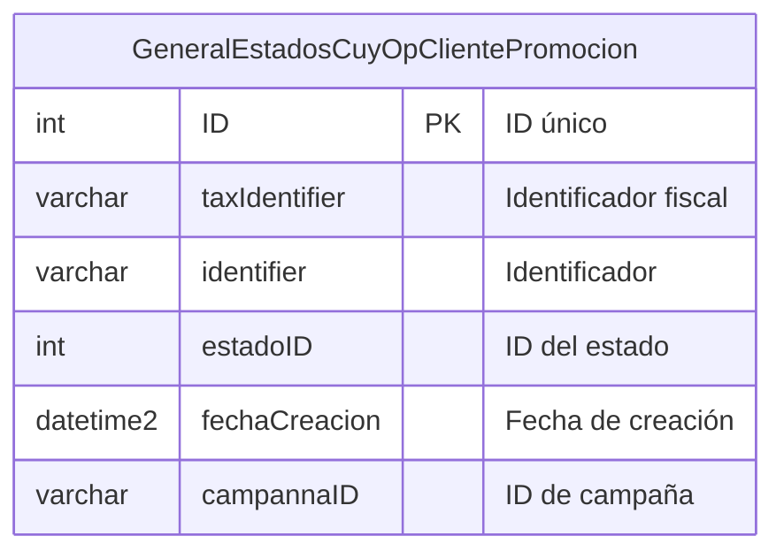
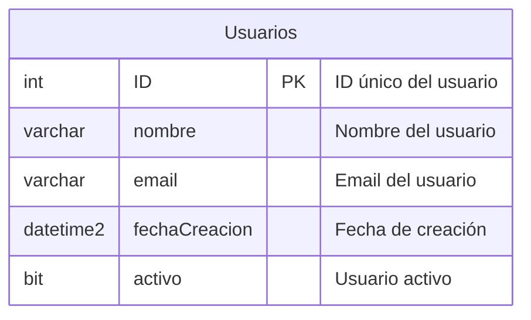
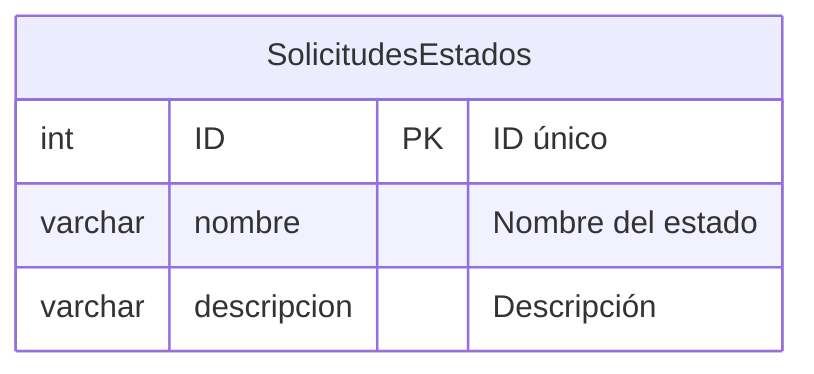
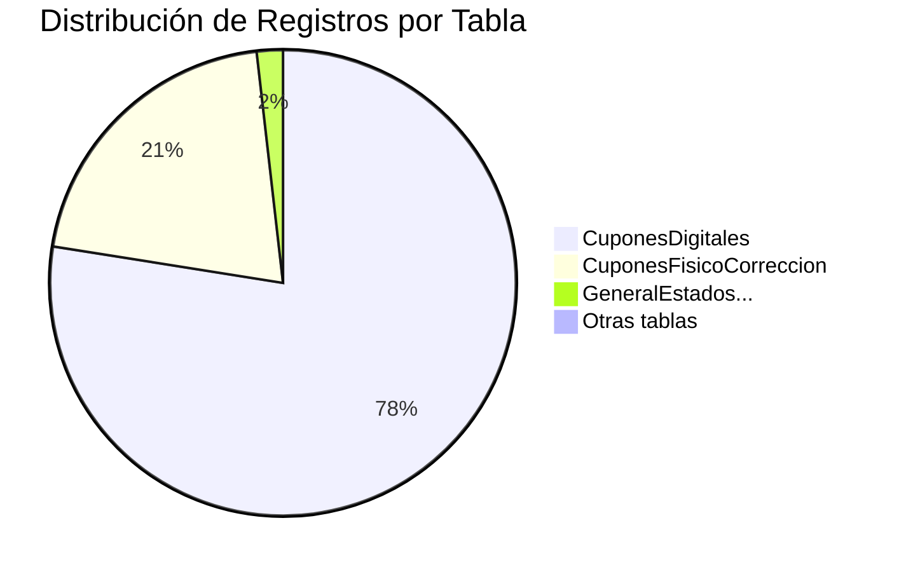
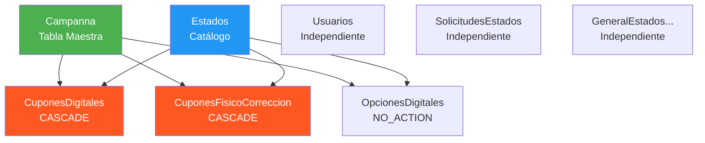

# Tablas Individuales - Diagramas Mermaid

## 1. Tabla Campanna (Central)

## 2. Tabla CuponesDigitales (45M registros)

## 3. Tabla CuponesFisicoCorreccion (12M registros)

## 4. Tabla Estados (Catálogo)

## 5. Tabla OpcionesDigitales

## 6. Tabla GeneralEstadosCuyOpClientePromocion (1M registros)

## 7. Tabla Usuarios

## 8. Tabla SolicitudesEstados

## Diagrama de Volumen de Datos

## Diagrama de Dependencias

